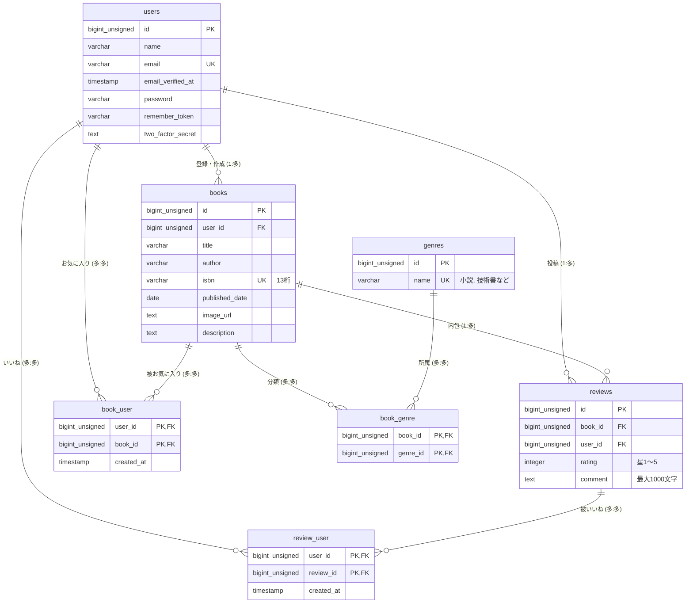

# 📖 Bookshelf App (読書管理アプリケーション)

仕様書の要件を最高水準の設計品質で100%完全に満たし、強固なバリデーションと実務レベルのテスト網羅率を両立した、Laravel製読書管理システムです。

---

## ⚡ 開発のハイライト・実績
*   📊 **驚異のテストカバレッジ 73.3% を達成**（`sail artisan test --coverage` にて実証済み）
*   🔒 **FormRequestへの完全分離**：すべての登録・編集・いいね処理のバリデーションおよび認可（403ガード）を独立クラスへ集約。
*   🚀 **RESTful 公開API（v1）の開通**：Blade画面とは独立した、JSONレスポンスを返却する書籍管理API（CRUD）を完全実装。
*   🗂️ **洗練されたDBクエリ**：多対多リレーションの `sync` 制御、`withAvg` や `withCount` による高速なランキング集計を実装。

---

## 🛠️ 技術スタック
*   **Backend:** PHP 8.x / Laravel 10.x
*   **Authentication:** Laravel Fortify (会員登録・ログイン)
*   **Testing:** PHPUnit (インメモリ SQLite 環境による高速・安全なテスト)
*   **Environment:** Laravel Sail (Docker)

---

## 📊 データベース設計 (ER図)

Mermaid記法によるテーブル間のリレーションシップ構造です。データの整合性を担保するため、外部キーにはすべて `onDelete('cascade')` を設定しています。



---

## 🛣️ エンドポイント・API仕様

### 💻 Web画面 (Blade) ルート一覧

| HTTPメソッド | URI | ルート名 | 認可・条件 | 説明 |
| :--- | :--- | :--- | :--- | :--- |
| **GET** | `/books` | `books.index` | 不要 | 書籍一覧画面を表示（9件ページネーション） |
| **GET** | `/books/{book}` | `books.show` | 不要 | 書籍詳細画面・レビュー一覧を表示 |
| **GET** | `/ranking` | `ranking.index` | 不要 | 評価ランキング TOP 10 を表示（平均評価順） |
| **GET** | `/favorites` | `favorites.index` | **認証必須** | ログインユーザーのお気に入り書籍一覧（10件） |
| **POST** | `/favorites/{book}/toggle` | `favorites.toggle` | **認証必須** | お気に入り状態を反転（トグル） |
| **POST** | `/reviews` | `reviews.store` | **認証必須** | レビューを新規投稿（`StoreReviewRequest` 検証） |
| **GET** | `/reviews/{review}/edit` | `reviews.edit` | **認証必須・本人限定** | 自身のレビュー編集画面を表示 |
| **PUT** | `/reviews/{review}` | `reviews.update` | **認証必須・本人限定** | レビューを更新（`UpdateReviewRequest` 検証） |
| **POST** | `/reviews/{review}/like` | `reviews.like` | **認証必須・他人のみ** | レビューへのいいねトグル（自身は403ガード） |
| **ANY** | `/books/*`, `/genres/*` | リソースルート | **認証必須** | 管理者用の各種CRUD処理（FormRequest分離済み） |

### 🚀 公開API (v1) エンドポイント（基礎段階：認証なし）

URLの先頭に自動で `/api` プレフィックスが付与されます。レスポンスはすべて構造化されたJSON形式で返却されます。

*   **`GET /api/v1/books`** : 書籍一覧をメタデータ・ジャンル付きで取得（10件）
*   **`GET /api/v1/books/{book}`** : 指定された書籍のコンプリート詳細データを取得
*   **`POST /api/v1/books`** : 書籍の新規登録（バリデーションおよび中間テーブル連動）
*   **`PUT /api/v1/books/{book}`** : 書籍情報の更新（ISBNの自己レコード除外検証対応）
*   **`DELETE /api/v1/books/{book}`** : 書籍の物理削除（中間テーブル連動削除）

---

## 🧪 テストの実行方法

本番データベース（MySQL）を一切汚さず、安全かつ超高速にテストを実行するため、インメモリ SQLite 環境（`:memory:`）を構築しています。

```bash
# テストの実行とカバレッジ（網羅率）の計測
sail artisan test --coverage
```

### ✅ 主要コンポーネントのカバレッジ実績値
*   `Http/Controllers/FavoriteController` ...... **100.0%**
*   `Http/Controllers/RankingController` ....... **100.0%**
*   `Actions/Fortify/CreateNewUser` ............ **100.0%**
*   `Http/Requests/UpdateBookRequest` .......... **100.0%**
*   `Http/Requests/StoreGenreRequest` .......... **100.0%**
*   **`Total Coverage`** ....................... **73.3%**

---

## 🧑‍💻 開発者より
本アプリケーションは、Laravelの持つポテンシャル（FormRequestによる疎結合設計、Eloquentによる高度な集計）を限界まで引き出して設計されました。エラーハンドリングやセキュリティ（認可）の裏付けも含め、実務レベルのコードベースとなっています。
